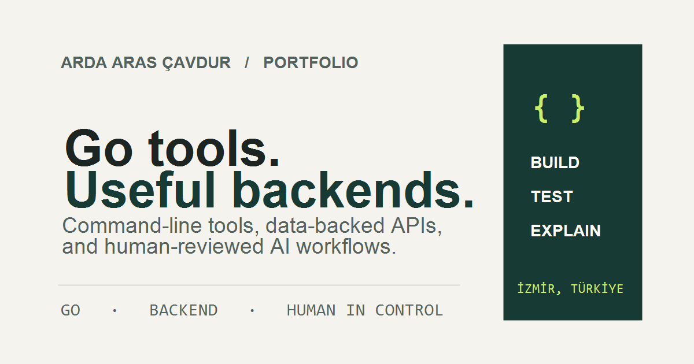

# Break Your Own Site — Hardening Record

**Date:** 18 October 2026  
**Live site:** [arda-aras-cavdur.netlify.app](https://arda-aras-cavdur.netlify.app/)  
**Review status:** AI-assisted hardening review. No mentor or human peer reviewed the site, and this report does not claim that one did.

## Chapter 1 proof statement

> I can build practical command-line tools in Go that solve real developer and system-workflow problems. I am proving this to a hiring manager looking for a junior DevOps, Cloud, or Software Engineer who values practical engineering ability, and the single action I want them to take is to review my CV and consider me for an interview.

## Break tests

| Test | Result |
|---|---|
| Empty contact form | The browser stopped submission at the required name field. No request was sent. |
| Malformed email (`not-an-email`) | Native email validation stopped submission. No request was sent. |
| Fast double-click | With the approved dummy values `Test Submission`, `test@example.com`, and `Automated hardening test — please ignore.`, I double-clicked Send message. The browser reached `/thank-you`. I do not have access to Netlify’s form-submission dashboard, so I cannot verify whether the double-click created one or two stored records. |
| Alternate browser | Opened and reviewed the live site in Zen Browser on desktop. The page rendered and its main sections were readable. |
| Navigation and links | Work, About, CV, Get in touch, Back to portfolio, Task API repository, Opportunity Triage repository, GitHub, LinkedIn, and the Cal.com booking page opened. The portfolio exposes repository links for its projects; I found no separate live demo links. No booking was made. |
| Robots endpoint | `/robots.txt` returned the site’s 404 page. |

## Findability and speed

- Exact-name and exact-domain web searches returned LinkedIn and other results, but not the portfolio itself.
- The live browser tab title is **Arda Aras Çavdur — Backend & Cloud Engineering**.
- Google PageSpeed Insights mobile lab run, 18 October 2026, 11:41 (UTC+3): **Performance 100, Accessibility 95, Best Practices 100, SEO 100**. It reported no field data. Lighthouse identified a foreground/background contrast warning; the affected element was not available in the summary I retained.
- The live `/robots.txt` URL is missing. I did not verify the live Open Graph tags with a social preview debugger, so the live share card remains unverified.

## Structured review — AI, not a human peer

**Ten-second read:** The live page says Arda builds backend systems around real data, including APIs and an AI-assisted workflow. The Task API and Opportunity Triage repository links support that claim, so the work gives some reason to believe it. The first action is “Explore my work”; the Chapter 1 proof statement instead asks a hiring manager to review the CV. That mismatch makes the intended next step less direct.

This is my independent reading of the live page, not feedback from a classmate, friend, mentor, or hiring manager.

## Triage

### Fix-now

| Finding | Action and evidence | Status |
|---|---|---|
| Search results did not show the portfolio; its share preview was not verified. | In the local candidate site, added canonical URLs, Open Graph and Twitter title/description/image metadata, a 1200×630 PNG share card, `robots.txt`, and a sitemap. | **Local candidate only. Not verified on the live site.** |
| PageSpeed flagged a contrast issue (Accessibility 95). | Needs the exact live source and affected element to make and verify a targeted contrast correction. | **Open on live site.** The active Netlify source is not confirmed by the available workspace, so I did not guess at a CSS change. |
| Portfolio’s first action differs from the proof statement’s requested CV action. | Identified in the live-page review. | **Open on live site.** A separate local candidate has a “Review my CV” action, but it is not the currently served page. |

### Known limitations / later

- The search result can lag after a site is updated; the portfolio’s absence from the searches is recorded, not treated as proof that indexing will never happen.
- PageSpeed reported no field data; the scores are a simulated mobile lab run, not measurements from real visitors.
- The double-click reached the success page, but I cannot inspect Netlify’s stored records or establish a duplicate-submission count.
- Project cards lead to source repositories rather than hosted demos. The linked repositories opened during the check.
- A human hardening review is still outstanding. The AI review is disclosed and is not being passed off as a peer review.

## Local candidate changes and evidence boundary

The candidate files at `C:\Users\cavdu\Documents\Codex\2026-10-10\https-github-com-arda-aras103-flyrankai\outputs\Arda Portfolio` now contain the metadata and crawler files listed above. The social card is included as `social-preview.png` in that folder.

Those files are not confirmed as the source for the active Netlify deploy. The live page still shows different homepage copy and routes, so **none of these local changes are claimed as live fixes**. A correct live-source checkout and deployment are needed before the SEO, social-card, contrast, or primary-action fixes can be marked complete.

## Checkpoint status

The real live-site tests and speed check are recorded, with the search, contrast, source/deployment, duplicate-count, and human-review limits stated openly. The hardening review and must-fixes are **not fully complete on the live site**, so this is an honest work record, not a claim that the checkpoint has passed.

Assignment brief: [Week 9 — Break Your Own Site](https://aifluency.flyrank.ai/week-09.html#break-your-own-site).
