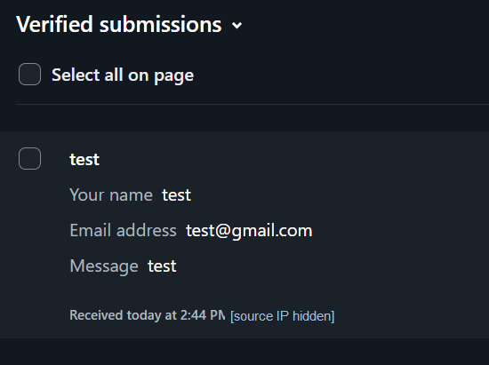
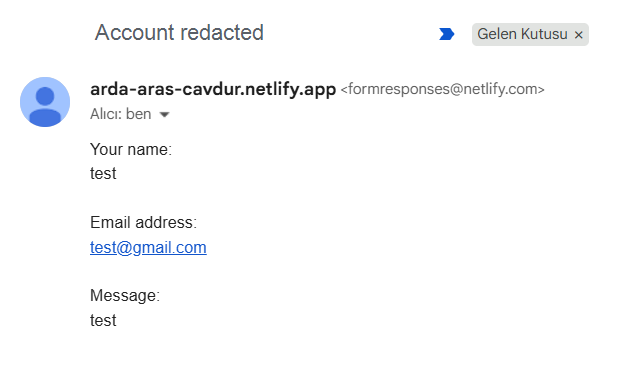

# Make It Do Something — Contact Form

## What the feature does

The portfolio has one new dynamic feature: a contact form. A visitor enters a name, email address, and message, then submits it from the homepage. The form has a small hidden spam-trap field and sends the visitor to `thank-you.html` after Netlify accepts the submission.

## Backend and data flow

A backend is the part of a website that runs on a server and handles work the browser should not do by itself. My portfolio pages are static files, so they do not have their own server code. Netlify Forms provides the backend for this form.

When the site is deployed, Netlify scans the HTML and looks for the form named `contact`. When a visitor submits it, the browser sends the named fields to Netlify with an HTTP POST request. Netlify records the submission in the site's Forms area. I can also turn on an email notification there, so a new message reaches my inbox. After a successful submission, Netlify returns the visitor to my thank-you page. The form does not send messages directly from my computer, and the visitor's email address is not used as the sender address.

I used Netlify's built-in form handler instead of writing a custom server or JavaScript. On Netlify's current credit-based Free plan, form submissions are free; older legacy plans have different usage limits. See [Netlify Forms setup](https://docs.netlify.com/manage/forms/setup/) and [Forms usage and billing](https://docs.netlify.com/manage/forms/usage-and-billing/).

## Live test and evidence

I tested the deployed form on 16 October 2026. Netlify listed the test as a verified submission, and the notification email arrived in my inbox. The screenshots below show both parts of the test. The repository copies hide the inbox address and source IP.

